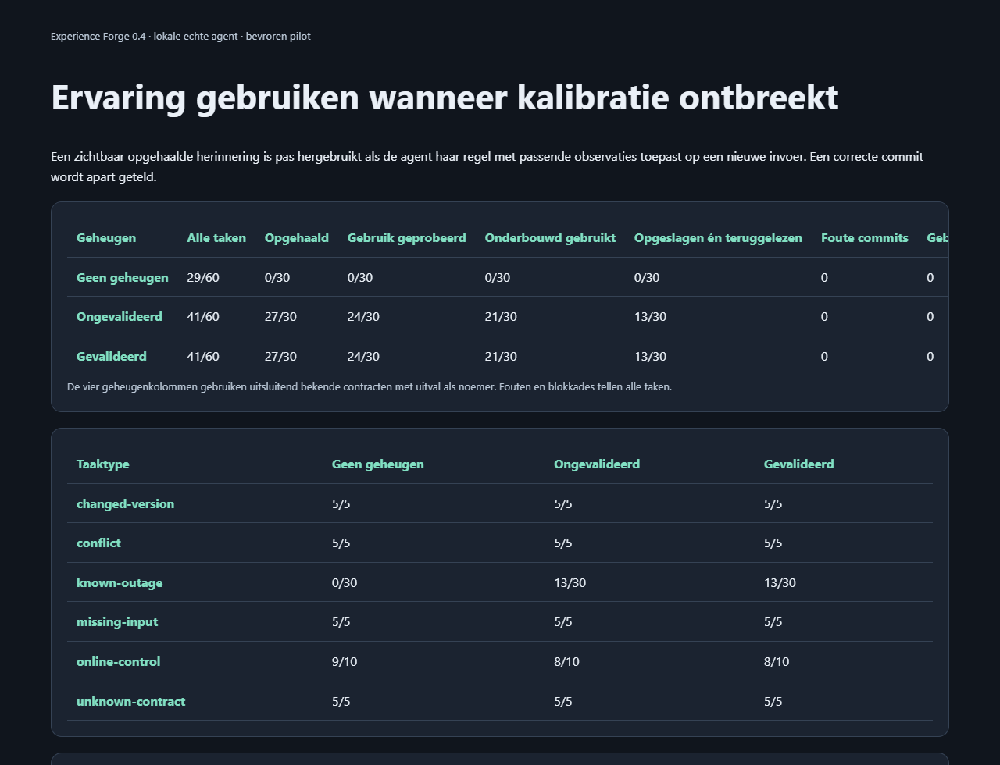

# Experience Forge

[](https://github.com/assistifyai405/experience-forge/actions/workflows/checks.yml) · [Release v0.5.0](https://github.com/assistifyai405/experience-forge/releases/tag/v0.5.0)

**Observable external-memory reuse when fresh calibration is unavailable.**

A local research prototype that turns observed connector experience into typed, persistent rule candidates. One real tool agent, one synthetic affine connector family, three memory treatments, five frozen seeds and replayable evidence. Retrieve a memory, apply its rule with supporting observations, then verify the committed state: those are three separate outcomes.

## Daily use in local workchats

The **0.5.0 public release** includes a portable daily-workchat adapter alongside the unchanged 0.4.0 research pilot. It recalls evidence-backed lessons before a task and records useful observations afterwards. Project-specific lessons stay separate; portable workflows require explicit selection.

```bash
python -m daily_workchat.forge_daily begin --project . --chat your-actual-chat-id --query "release verification"
python -m daily_workchat.forge_daily status
```

Personal data is stored outside this checkout. The public repository contains **no user memory bank, chat logs or personal configuration**. [Daily workflow setup](docs/DAILY-WORKCHAT.md) covers the global skill, local MCP tools and CLI fallback. This adapter does not automatically connect ordinary ChatGPT web/mobile chats and does not establish new model-performance results.

## Recorded pilot

| Treatment | Completed tasks | Supported outage reuse | Import committed and read back |
| --- | ---: | ---: | ---: |
| No memory | 29/60 | 0/30 | 0/30 |
| Unvalidated model-generated memory | 41/60 | 21/30 | 13/30 |
| Independently validated memory | 41/60 | 21/30 | 13/30 |

All-task completion includes required safe abstention; the two outage columns use only the 30 known-contract outage opportunities. Eight supported, correctly stored imports per memory treatment lacked the required readback and remain completion failures. **Validation did not improve final completion.** No wrong commits occurred. These are authored-pilot observations, not a general intelligence or superiority claim.

Without memory, outage tasks deliberately lack historical evidence. The study measures the usefulness of that external information after conversation reset; it does not change model weights or test independently learned mathematical structure. Exact arithmetic and write protection are supplied tools, shared by all treatments.

[Full results and failures](docs/REUSE-RESULTS.md) · [Frozen protocol](docs/REUSE-PROTOCOL.md) · [Evidence](evidence/README.md) · [Attribution](docs/ATTRIBUTION.md)

## Verify the actual captured run

Requires only **Python 3.11+**. No packages, API key, model download or Ollama service are needed for replay:

```bash
python -X utf8 scripts/verify_publication.py
python -X utf8 scripts/offline_tests.py
```

The bundled evidence ZIP is 171 KB (approximately), contains the full captured 0.4 pilot and is checked by SHA-256 before extraction. Verification regenerates fixture labels, rechecks actual proposals and qualification, reopens SQLite condition memory and replays **195 captured agent rollouts**, including **180 final rollouts and 763 inference calls**, through the real tools. It makes **zero new model calls** and denies Python network connections. Scripted test/reference controls are separate from actual model scores.

**53 original tests, 12 daily-adapter and installation tests and the full captured replay passed locally with UTF-8 enabled.** Hosted CI runs Ubuntu/Windows on Python 3.11/3.14; its status is visible on GitHub. [Contribution instructions](CONTRIBUTING.md) explain how to preserve the source-bound evidence when changing experimental code.

## Inspect the report



Download or open [the standalone report viewer](reports/reuse-viewer/index.html) locally. Its expandable sections show all task types, per-seed differences, realized consumption and limitations. Tables scroll within narrow screens. Its linked JSON/JSONL copies are byte-identical to the original evidence. The derived viewer clarifies the readback metric and wraps long hashes; the original frozen viewer remains in the evidence ZIP.

## Run a new local experiment

Requires an already-running local Ollama service and an **already-installed non-cloud `qwen3.5:4b`**. The runner never installs software or pulls a model. It accepts only loopback HTTP and rejects remote-backed model artifacts.

```bash
python -X utf8 -m experience_forge reuse-benchmark --seed 60701 --trials 5 --output runs/my-new-pilot
python -X utf8 -m experience_forge reuse-verify --output runs/my-new-pilot
```

Windows and shell starters are included. Every run needs a fresh output directory; uncertain provider requests are not retried automatically. For a new scientific study, freeze a distinct protocol/seeds before inference and keep development cases separate. Fixed tools, prompts and limits match across conditions, but realized tokens/time need not match.

The recorded study used 763 local inference calls, 866,003 input tokens and 47,240 output tokens. Shared training/proposals were collected once and allocated equally to each condition. The separate development smoke is excluded from final scores. A prior, separately authorized **one-call paid Jev design review** used 2,281 input and 179 output tokens; monetary charge unknown. It was design advice, not evaluated-agent inference. Its public request/result are in `reviews/jev-prompt-20261012/`. Neither replay, test commands nor CI performs paid model calls.

## Research boundaries and provenance

The task family, affine formula and exact arithmetic helper are authored. The initial agent prompt contains no historical rules, transcripts, condition names, task categories or gold targets. A final rollout starts fresh messages and an isolated write world, reopening only its condition's memory. Observed retrieval, attempted use, supported normalization and verified completion are logged separately.

Five authored seeds are the independent units. Paired completion gains versus no-memory average 20 percentage points, with seed differences ranging from 8.33 to 33.33 points; those descriptive differences are not confidence bounds. Shared write checks can mask memory errors at the commit stage. The null validation result and omitted readback are retained rather than tuned away.

Earlier results remain documented: [0.3 ceiling result](docs/EXECUTION-RESULTS.md) and [0.2 pilot](docs/AGENT-RESULTS.md). Complete matching historical source/data and development evidence accompany the full publication release ZIP; they are kept outside the small Git checkout. From that unpacked package, historical replay runs in `history/v0.3.0/experience-forge` using `--output evidence/execution-complete`.

The public copy preserves every experimental source hash and raw model trace. Workstation paths and unrelated credential-presence/host metadata are removed or anonymized outside those traces. [Publication provenance](PUBLICATION-PROVENANCE.json) records the changes; original private archives remain preserved locally.

No independent external replication, native Windows model inference, other-model coverage or production readiness is claimed. No affiliation or endorsement by OpenAI, Qwen, Ollama or TypeSafe is implied. [MIT license](LICENSE) · [Citation](CITATION.cff) · [Release notes](docs/RELEASE-NOTES-0.4.0.md).
